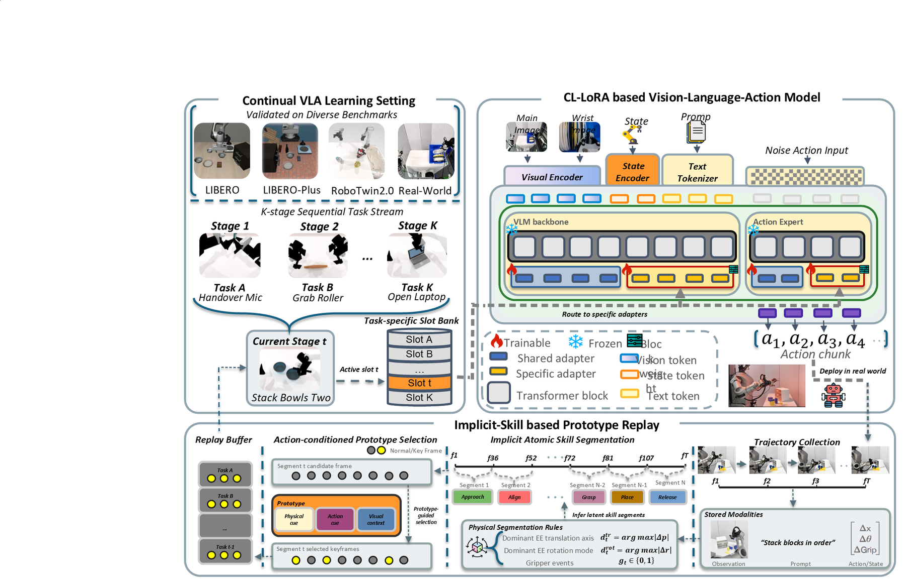
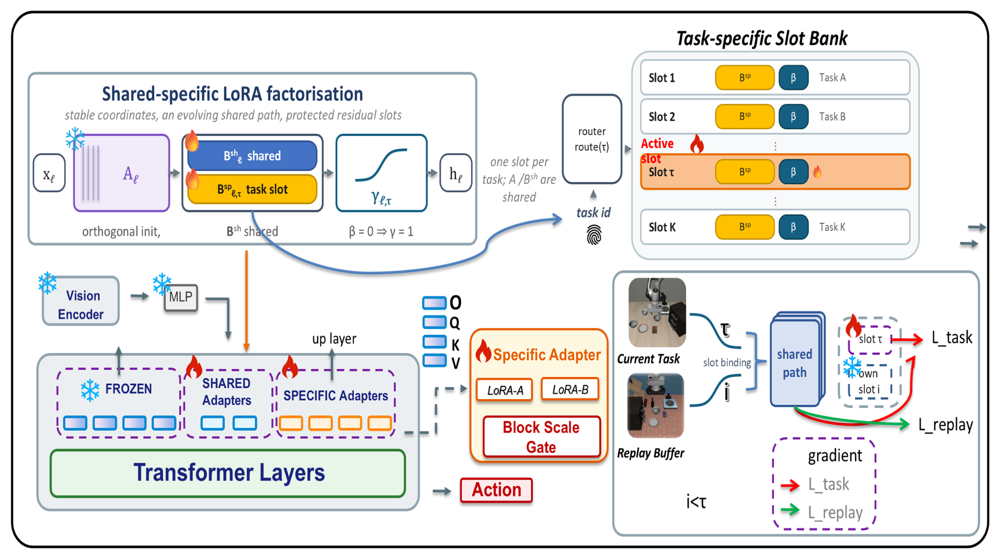
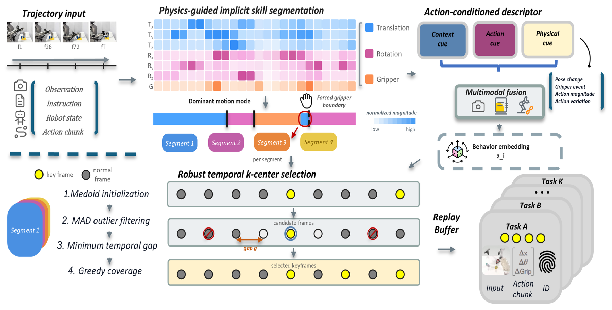

# CL-LoRA on OpenVLA

**Continual learning for a 7B vision-language-action model.**
A parameter-efficient framework that lets **OpenVLA-7B** acquire a *stream* of manipulation tasks without catastrophically forgetting the ones it already knew.

*Figure 1 — The continual VLA setting (left) and the two mechanisms (right): task-routed shared/specific LoRA adaptation inside a frozen backbone, plus action-conditioned prototype replay that supplies old-task behavioural anchors.*

---

## Headline result

Four bimanual tasks learned **sequentially** on RoboTwin 2.0 (Handover Mic → Grab Roller → Stack Bowls Two → Open Laptop). Success rates measured after the **final** stage, 50 episodes per task, oracle task routing for every routed method:

| Method | Task A | Task B | Task C | Task D *(newest)* | Old-task mean |
|:--|:--:|:--:|:--:|:--:|:--:|
| Sequential LoRA (no protection) | 0.00 | 0.00 | 0.00 | 0.82 | **0.00** |
| CL-LoRA, no replay | 0.00 | 0.78 | 0.54 | 0.88 | **0.44** |
| **CL-LoRA + prototype replay** *(this repo)* | **0.78** | 0.69 | 0.62 | **0.87** | **0.70** |
| CL-LoRA + uniform replay *(identical frame budget)* | 0.00 | 0.67 | 0.61 | 0.75 | **0.43** |

**The oldest task goes 0.00 → 0.78, the old-task mean 0.44 → 0.70, and the new task pays nothing (0.88 → 0.87).** Uniform replay at an identical budget recovers nothing (0.43, i.e. no better than no replay at all) and *costs* the new task 13 points — so the gain comes from **which frames are stored**, not from replay as such.

---

## The problem

Vision-language-action models such as OpenVLA are usually adapted to a new task with parameter-efficient fine-tuning — freeze the 7B backbone, train a small low-rank adapter. That recipe is fine for **one** task, and badly mismatched to a deployed robot, which receives tasks **one after another**:

* Only the current task's demonstrations are available; storing and retraining on everything from the past is not an option.
* Naively continuing to train the same adapter makes new gradients **overwrite** old skills. Sequential LoRA on the stream above drives *every* earlier task to 0%.
* In a VLA this forgetting is not a lost class boundary — it is a **drifted conditional action distribution** `π(a₁:ₕ | o, l, s)`. Under an old observation, instruction and robot state, the policy still emits an action chunk that looks locally plausible but is physically wrong for the old task. Nothing throws an error; the robot simply fails.

Recovering from this needs stability in **two** places at once — in **parameter space** (so new gradients cannot rewrite every old skill) and in **data space** (so the shared parts of the network keep being told what old tasks look like).

---

## Method

The framework couples two mechanisms. It is model-agnostic; this repository is the **OpenVLA-7B / OpenVLA-OFT** instantiation, validated on LIBERO and RoboTwin 2.0.

### 1 · Task-routed shared-specific adaptation (CL-LoRA)

Each low-rank update is factored into three parts with **different roles and different lifetimes**:

    y_ℓ = W_ℓ x_ℓ + (α/r) · γ_{ℓ,τ} · (x_ℓ A_ℓ) · B^{route(τ)}_ℓ

| Component | Role | Lifetime |
|:--|:--|:--|
| **A_ℓ** — orthogonally initialised down-projection | a *stable low-rank coordinate system*; stores no task knowledge | **frozen forever** |
| **B^sh_ℓ** — shared up-projection | cross-task adaptation that keeps evolving | **trainable across the whole stream** |
| **B^sp_{ℓ,τ}** — task-specific slot | one compact residual slot per task, kept in a slot bank | per task, **protected** |
| **γ_{ℓ,τ} = 1 + 0.5·tanh(β)** — bounded gate | how strongly task τ injects its residual into layer ℓ | per task, range (0.5, 1.5) |

Layers are partitioned into **shared** layers (which use `B^sh`) and **specific** layers (which are routed to the task's own slot). At inference the model uses the shared path plus the slot of the requested task.

The point of freezing `A` is that a stored slot is only meaningful *relative to the coordinate system it was trained under* — freeze `A` and every slot stays plug-and-play forever.

### 2 · Action-conditioned prototype replay (ACPR)

Parameter isolation alone cannot keep the **shared** path compatible with old tasks, so after each task the repo builds a small replay memory — but it does not sample frames uniformly:

1. **Physics-guided implicit skill segmentation** — partition each demonstration into atomic skill segments using end-effector translation/rotation, gripper transitions and motion intensity. Short segments are merged; meaningful gripper-transition segments are kept.
2. **Action-conditioned multimodal descriptor** — every candidate frame gets a fused descriptor `z = Norm([√w_c·c ; √w_a·a ; √w_p·p])` from **context** (VLA prefix), **action-token** (action-generation path) and **physical motion** features, with `w_a = 0.50` — replay should preserve *how the task is performed*, not just visual diversity.
3. **Robust temporal k-centre selection** — per segment: start from the medoid, drop outliers with a MAD rule, enforce a minimum temporal gap, then greedily add the frames that most reduce the segment coverage error. Each segment contributes a fixed quota, so memory size scales with the number of *skill phases*, not with demonstration length.

Because segmentation uses physics only (no model) and selection is per-segment, the buffer stays small and balanced even when demonstrations are long and mostly static.

### How the two mechanisms meet

During training of task `t`, current-task samples update the **shared path** and the **current slot**; replayed samples are routed through **their own old slot** to reconstruct old behaviour, but gradients to those old slots are **stopped**. Replay therefore never keeps training old adapters — it constrains the shared path (and the global action interface) to stay compatible with them. The shared path additionally uses the full learning rate on steps that contain replay, and a softly reduced rate when no old-task evidence is in the batch.

---

## Results

**RoboTwin 2.0** — 4-stage bimanual stream, 50 episodes/task, `γ = 0`:

| Stage (checkpoint) | Method | A | B | C | D |
|:--|:--|:--:|:--:|:--:|:--:|
| after B | no replay | 0.36 | 0.94 | — | — |
| | prototype replay | **0.74** | 0.96 | — | — |
| | uniform replay | 0.89 | 0.94 | — | — |
| after C | no replay | 0.00 | 0.84 | 0.92 | — |
| | prototype replay | **0.76** | 0.78 | 0.94 | — |
| | uniform replay | 0.04 | 0.84 | 0.86 | — |
| after D | no replay | 0.00 | 0.78 | 0.54 | 0.88 |
| | **prototype replay** | **0.78** | 0.69 | 0.62 | **0.87** |
| | uniform replay | 0.00 | 0.67 | 0.61 | 0.75 |

With replay the oldest task stays **flat** across stages (0.74 / 0.76 / 0.78); without it, it hits zero after two. Uniform replay looks acceptable after one stage (0.89) and then collapses (0.04 → 0.00) — it covers the trajectory broadly but does not pin down the decisive phases.

**LIBERO** — 4-stage stream (spatial → spatial → object → goal), specific-`A` frozen:

| Stage-4 checkpoint | A | B | C | D |
|:--|:--:|:--:|:--:|:--:|
| no replay | 0.44 | 0.66 | 0.94 | 1.00 |
| **+ prototype replay** | **0.96** | **0.94** | 0.88 | 1.00 |

---

## Repository layout

    openvla-oft/                          OpenVLA-OFT fork (training + evaluation stack)
      vla-scripts/
        cl_lora.py                        CLLoRALinear, adapter injection, task-slot bank
        train_cl_lora.py                  continual-learning trainer (stages, replay, task bank)
        finetune.py                       standard LoRA baseline / single-stage fine-tuning
        replay_dataset.py                 replay-buffer Dataset feeding the trainer
        build_replay_buffer_openvla.py    ACPR buffer builder - LIBERO
        build_replay_buffer_robotwin.py   ACPR buffer builder - RoboTwin (bimanual)
        build_uniform_replay_buffer*.py   uniform-replay baseline (budget-matched)
        analyze_cl_lora_drift.py          per-stage drift of A / B / block-scale
        analyze_film_drift.py             language-modulation (FiLM) drift
        analyze_buffer_coverage.py        what frames each buffer actually contains
      experiments/robot/libero/           LIBERO evaluation (task-bank restore)
      experiments/robot/openvla_utils.py  shared model / adapter loading

    RoboTwin-main/policy/openvla-oft/     RoboTwin 2.0 policy server + evaluation
      deploy_policy.py                    inference with task-bank routing
      eval_sequence.sh / eval_multi_gpu.sh  multi-stage, multi-task evaluation drivers

    run_v39*.sh / run_v41*.sh / run_lora*.sh   experiment launchers (stage A -> D)

    REPLAY_BUG_NOTES.md                   the full experiment log (including negative results)
    CLAUDE.md                             architecture / code map
    modified_libero_rlds/                 RLDS metadata (the .tfrecord data is not tracked)

---

## Quick start

    # 1. environment
    cd openvla-oft
    pip install -e .
    pip install "flash-attn==2.5.5" --no-build-isolation

    # 2. build a prototype replay buffer from the FIRST task (ACPR)
    python vla-scripts/build_replay_buffer_robotwin.py \
      --vla-path  <openvla-7b> \
      --data-root-dir datasets/rlds --dataset-name aloha_handover_mic_clean \
      --stats-path <taskA-checkpoint>/dataset_statistics.json \
      --output-dir replay_buffers/taskA --num-episodes 10 --top-k 3 --overwrite

    # 3. learn the NEXT task with CL-LoRA + replay
    torchrun --standalone --nproc_per_node 4 vla-scripts/train_cl_lora.py \
      --vla_path <openvla-7b> --dataset_name aloha_grab_roller_clean \
      --stage 2 --previous_checkpoint_dir <taskA-checkpoint> --previous_checkpoint_step 30000 \
      --use_cl_lora True --lora_rank 16 --shared_depth 8 --first_lora_layer 16 \
      --orthogonal_init True --freeze_a True --use_block_scale True \
      --use_replay True --replay_buffer_dirs replay_buffers/taskA \
      --replay_every_n_steps 4 --replay_loss_weight 0.5 \
      --batch_size 2 --learning_rate 5e-4 --max_steps 40000

    # 4. evaluate every task seen so far
    bash policy/openvla-oft/eval_sequence.sh <checkpoint> 4,4,5,5,6,6,7,7 50 tag A B C D

The shell launchers at the repository root (`run_v41r_resumeC.sh`, `run_v39b9_layermask.sh`, ...) wrap exactly these commands with the layer masks, freezing policies and evaluation gates used for the reported numbers — they are the fastest way to reproduce a specific row of the tables above.

---

## Documentation

| Document | What is in it |
|:--|:--|
| `REPLAY_BUG_NOTES.md` | The complete experiment log: every configuration, every evaluation, **and the negative results** (why uniform replay fails, which drift channels replay cannot reach, how several early conclusions were overturned) |
| `CLAUDE.md` | Architecture and code map of the OpenVLA-OFT fork |
| `RoboTwin_CL_handover.md` | RoboTwin platform notes and evaluation protocol |
| `Pi_CL-Lora_Prototype_Replay_README.md` | How this port relates to the π0.5 reference implementation |

If you only read one thing, read the **"replay reachability"** criterion in `REPLAY_BUG_NOTES.md`: replay can only repair damage whose gradient actually reaches the evaluation path, and a task's tolerance for that damage must be enough. Most of the non-obvious behaviour of this framework — including what fails and why — follows from it.

---

## Citation

The method is described in a manuscript currently under review (working title *PROPEL-VLA: Prototype-Guided Parameter-Efficient Lifelong Adaptation for Vision-Language-Action Models*). Citation information will be added here once it is public.

## Acknowledgements

Built on [OpenVLA](https://github.com/openvla/openvla) and the OpenVLA-OFT fine-tuning stack, and evaluated on [LIBERO](https://github.com/Lifelong-Robot-Learning/LIBERO) and [RoboTwin 2.0](https://github.com/RoboTwin-Platform/RoboTwin). The LoRA orthogonal-initialisation / freeze-`A` design follows the π0.5 CL-LoRA reference implementation.
